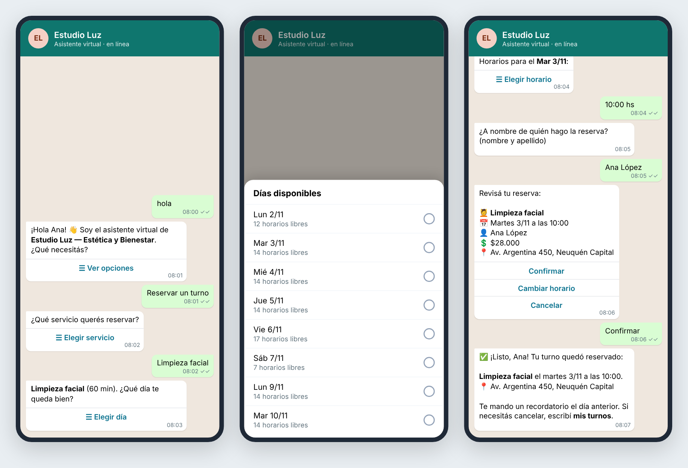

# WhatsApp Booking Assistant for small businesses

A WhatsApp assistant that **books, lists and cancels appointments 24/7**, answers the usual questions (prices, opening hours, address, payment methods), **reminds customers the day before** and **hands the chat to a person** when needed — built on the official **WhatsApp Cloud API** (Meta).

It is made for appointment-based businesses: beauty salons, barbers, clinics, physiotherapists, tutors, car workshops, studios. The demo business is a fictional beauty studio in Neuquén, Argentina, so the conversation is in Spanish; every text and rule lives in two editable places (`business.json` and `booking/flow.py`).



*Real messages produced by the bot (`booking/flow.py`), shown in a phone mockup.*

## Why businesses want this

- Most customers prefer to contact businesses by WhatsApp, and they write at night and on weekends.
- No more back-and-forth to find a free time: the assistant only offers real free slots.
- Fewer no-shows thanks to automatic reminders with a one-tap "cancel" button that frees the slot.
- The owner gets every new booking or cancellation on their own WhatsApp and can ask for the day's agenda.

## Features

| | |
|---|---|
| **Native WhatsApp menus** | Interactive lists and reply buttons (no typing needed), with Meta's character limits enforced. |
| **Real availability** | Split opening hours, service durations, slot step, minimum notice, booking window, holidays. |
| **No double bookings** | The slot is re-checked inside a database transaction at confirmation time. |
| **Self-service** | "Mis turnos" lists upcoming appointments; customers can cancel only their own. |
| **FAQ by keywords** | Prices, hours and address generated from `business.json`, plus custom answers. |
| **Human handoff** | The bot pauses for 12 h in that chat and sends the owner a `wa.me` link; `reactivar <number>` resumes it. |
| **Owner commands** | `agenda`, `agenda mañana`, `reactivar <number>` from the owner's phone. |
| **Reminders** | `python -m booking remind` (hourly cron) sends "hoy" or "mañana" reminders. Uses buttons inside WhatsApp's 24 h window and an approved template outside it. |
| **Secure webhook** | `X-Hub-Signature-256` verification (the server warns at start-up if the app secret is missing), verify-token handshake, idempotent processing of Meta's retries, never returns 500. |
| **Try it offline** | `python -m booking simulate` runs the full conversation in the terminal. |
| **Tested** | 34 pytest tests (availability, conversation flow, time zones incl. daylight saving, webhook, reminders) and GitHub Actions CI. |

## Quick start (no Meta account needed)

```bash
python -m venv .venv
# Windows:  .venv\Scripts\activate      macOS/Linux:  source .venv/bin/activate
pip install -r requirements.txt
python -m booking simulate
```

Type `hola` and answer with the option numbers. See [`docs/sample-conversation.txt`](docs/sample-conversation.txt).

```bash
pytest -q
```

## Connect it to WhatsApp

1. Create an app at [developers.facebook.com](https://developers.facebook.com/) → add the **WhatsApp** product. Meta gives you a test number and a temporary token.
2. Copy `.env.example` to `.env` and fill `WHATSAPP_TOKEN`, `WHATSAPP_PHONE_NUMBER_ID`, `WHATSAPP_APP_SECRET`, a `WHATSAPP_VERIFY_TOKEN` of your choice and `OWNER_PHONE`.
3. Deploy the server (Docker, Railway, Render, a VPS) and note its HTTPS URL. For local testing use a tunnel such as `ngrok http 8000` after `python -m booking serve`.
4. In Meta → WhatsApp → Configuration, set the callback URL to `https://YOUR-URL/webhook`, paste the verify token, and subscribe to the **messages** field.
5. Schedule `python -m booking remind` every hour.
6. For production, add the business's own number and a permanent System User token, and get a reminder template approved (e.g. `turno_recordatorio` with 3 variables: name, service, date and time).

## Adapting it to a new client

Edit `business.json`: name, address, services (id, name, duration, price), opening hours per weekday, slot step, minimum notice, holidays and FAQ keywords. No code changes are needed for a typical salon, clinic or studio.

## Project structure

```
booking/
  business.py   # business profile from business.json
  slots.py      # availability engine
  db.py         # SQLite: appointments, conversation state, processed message ids
  flow.py       # conversation engine (pure: message in → messages out)
  whatsapp.py   # Cloud API payloads, sending, webhook parsing, signature check
  server.py     # Flask webhook
  reminders.py  # day-before reminders (24 h window aware)
  simulate.py   # terminal chat
business.json   # demo business
tests/
```

## License

MIT
